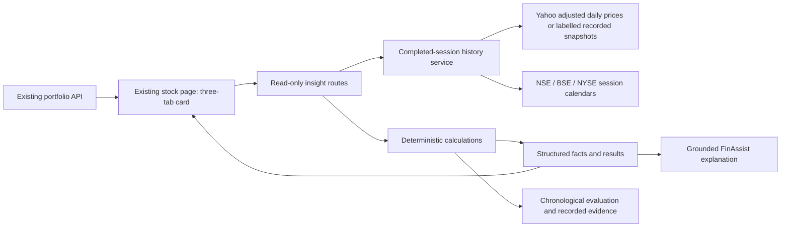

# FinAssist Explainable Stock Insights

The current project contribution is an integrated Stock Information card: Portfolio Fit, Unusual Movement and Historical Experience. These use established statistical methods. They are not price predictions, a novel financial algorithm, or validated investment recommendations. Earlier forecasting experiments remain in `research/` and are outside the current product narrative.

## Run locally

Use the installed Python 3.11 environment:

```sh
.venv_research/bin/python -m pip install -r requirements-insights.txt
PORT=5003 PORTFOLIO_STORAGE=sqlite .venv_research/bin/python app.py
```

Alternatively use `npm run dev:local`. `npm run demo:insights` opens the review app on port 5004 using the latest completed exchange session and fresh provider requests, with no fixed historical cutoff. Delayed provider data is explicitly labelled. Movement uses the latest stock/benchmark session with valid one-session returns; Portfolio Fit uses the latest common valuation date across all included holdings and the candidate. The actual analysis date and expected completed session are displayed. Missing sessions are never filled or bridged. Stale data is retried after at most one minute on the next insight request, and cached data is invalidated when a new session becomes eligible.

Open http://127.0.0.1:5003 and select Stock Information. Use `/?view=mobile` for the mobile template preview or `/?view=desktop` to force desktop; ordinary visits still detect the device. Portfolio Fit reads holdings through the existing portfolio API; it does not save a proposed purchase. Amount zero deliberately permits an unchanged-portfolio comparison.

The optional backup `npm run demo:insights:historical` runs on port 5005. Historical demonstrations are explicit and use recorded real price snapshots, never invented prices:

```sh
PORT=5005 PORTFOLIO_STORAGE=sqlite STOCK_INSIGHTS_AS_OF=2026-10-09T23:59:00Z STOCK_INSIGHTS_SNAPSHOT_DIR=insights/data .venv_research/bin/python app.py
```

The Stock Insight card labels this mode and its cutoff. Other dashboard sections retain their own provider data and are not historical replay. Do not describe the whole dashboard as synchronized to the insight cutoff. Current news is withheld in historical-demo mode. Snapshot inputs stay local in ignored `insights/data/`; they are not a licensed redistribution dataset. To obtain inputs on another laptop, run the download evaluation command below with network access. A cutoff later than the available data uses the latest available aligned prices with an explicit delay warning, never fabricated current information.

## Verification and study

```sh
.venv_research/bin/python -m pytest tests/test_insights.py tests/test_stock_news.py tests/test_research.py -q
node --test tests/test_insight_visuals.cjs
.venv_research/bin/python -m insights.evaluate --download
# Reproduce from the same recorded price files without downloading again:
.venv_research/bin/python -m insights.evaluate
```

[Results](RESULTS.md), [methodology](METHODOLOGY.md), [literature comparison](LITERATURE.md), [evidence checklist](READINESS.md), and [inspected historical examples](REAL_ALERT_INSPECTION.md) support later report and slides. Configuration is written before evaluation. Prediction rows, scenario rows, snapshot hashes, versions and coverage are retained in `artifacts/`. The study fixes its universe and final chronological 20% before evaluating; settings are not selected to maximize test results. Historical replay changes can be made only by restarting the server; cache contents must not mix analysis modes.

## Interfaces

- `GET /si/insights/movement?symbol=AAPL`
- `GET /si/insights/historical?symbol=TCS.NS&amount=10000&months=3`
- `POST /si/insights/portfolio-fit` with JSON `{"symbol":"AAPL","amount":10000,"holdings":[{"symbol":"MSFT","qty":2}]}`. This operation is read-only despite accepting a request body.
- Existing `/get` and `/chat` accept optional `insight_kind`, `insight_symbol`, `insight_amount`, `insight_months` and `insight_holdings` form fields for deterministic grounded explanations. Numerical explanations do not depend on an LLM API key.

Symbols must already be resolved to US tickers or Indian `.NS`/`.BO` tickers. Values in JSON returns, exposures, drawdowns and volatilities are fractions; the client converts them to percent. Monetary values use the specified currency. States are `ready`, `partial`, `empty_portfolio`, `insufficient_history`, `stale`, `unavailable` and `invalid_input`. Invalid inputs return HTTP 400; valid requests with unavailable provider data return an explicit status rather than fake data. Unknown insight paths return 404. All analytic results identify calculation version and, when price retrieval succeeds, observation date, coverage and provider mode. Up to 30 holdings and amounts from zero to 1 billion are accepted. No holdings are persisted by analysis endpoints or sent to an LLM.

Stock news uses Yahoo company news with a Google News RSS company-search fallback when Yahoo returns no usable recent articles. Only dated HTTP(S) links from the previous seven days are shown, with publisher names and retrieval timestamps. Duplicate headlines are removed. Provider failures are distinguished from empty results and cached for only one minute. Search results are contextual information, not independently verified company-event labels.

## Architecture



## Resource and deployment limits

No model training, FinBERT download or GPU is required for these features. Calculations use NumPy, pandas, scikit-learn and exchange calendars. Price requests have bounded provider/client waits and a 15-minute cache. Portfolio work has a 20-second admission budget; an already-running history request can finish up to 14 seconds later. Sector lookup is skipped when the budget is exhausted and remains Unknown. External providers and Supabase availability still affect the existing application. Hosted feasibility has not been tested. This implementation preserves existing routes and the application's username-only identity scheme. `PORTFOLIO_STORAGE=sqlite` explicitly selects a durable laptop database at `instance/portfolio.sqlite3`, with a visible laptop-storage label. Without it the existing Supabase storage remains selected. No automatic failover or migration occurs. The configured cloud service failed the current DNS/network connectivity check; local persistence is independently tested.

## Visual explanations

All three tabs lead with a plain-language question and a calculated takeaway. Portfolio allocation, market comparisons and historical money ranges use the existing API figures without changing the analysis formulas. Exact metrics, complete holdings and sectors, assumptions and data-quality warnings remain under “Numbers and methodology.” Every graphic has visible numerical text; colour and hover are supplementary. The drawdown timeline lists recorded events rather than inventing a price path. These interface changes have not been evaluated in a participant study.
