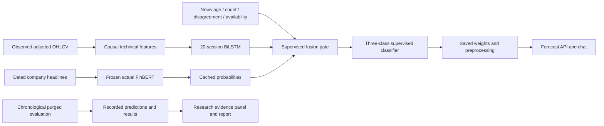

# FinAssist: Lightweight Financial Trend Prediction with News Freshness and Missing-News Awareness

**Working report source — not a verified final submission.**

## Preliminary pages
Title page, institutional certificate, declaration, acknowledgement, abstract, contents, figure/table lists and abbreviations must use the institution's actual template. Certificates/signatures are not generated or represented as signed. Student and guide metadata must be confirmed before export.

## Chapter 1 — Introduction
FinAssist integrates financial calculators, market information, portfolios and conversational assistance. This project investigates whether a small supervised predictor can use financial news without treating unavailable or old news as current evidence. The target is the direction of adjusted close-to-close returns across three trading sessions: below -0.75%, between the thresholds, and above +0.75%. Objectives are to implement genuine training, compare matched baselines, test missing/stale news, and integrate reproducible results into the existing application.

## Chapter 2 — Literature review
Araci's FinBERT provides financial sentiment classification, not proof of stock prediction. Xu and Cohen's StockNet studies text and price prediction. Existing gated cross-attention research establishes that multimodal gating itself is prior art. The current contribution is an applied implementation and controlled evaluation, not architectural priority. Dataset and model licenses and reuse must be acknowledged.

| Source | Role | Boundary of comparison |
|---|---|---|
| Araci (2019), https://arxiv.org/abs/1908.10063 | Frozen sentiment model | Sentiment classification is distinct from stock direction |
| Xu & Cohen (2018), https://aclanthology.org/P18-1183/ | Text/price prediction methodology | Different dataset; no direct metric comparison |
| MSGCA (2024), https://arxiv.org/abs/2406.06594 | Closest fusion prior art | Gating and attention are established techniques |
| Indian Stock Market News Dataset, https://zenodo.org/records/16991843 | Indian headlines | Sparse, date-only, six-month source |
| https://github.com/pmoe7/Stock-Market-Data | US headlines | Independently verify ticker relevance and dates |

## Chapter 3 — Methodology and design
Observed adjusted OHLCV flows through causal technical features and 20-session windows into a small bidirectional LSTM. Historical direction labels are computed separately and never enter input construction. Frozen ProsusAI/finbert produces positive/neutral/negative scores. A supervised scalar gate conditions fusion on age, count and disagreement; missing news zeros the gate. A classifier predicts three classes. Bidirectionality operates only inside the already observed historical window.

Date-only news is eligible only after its publication day. Samples share market-level chronological boundaries with 70/15/15 proportions. Targets crossing a boundary are purged. Normalization fits only the training partition. Adam uses learning rate 0.001, batch 32, at most 30 epochs and five-epoch early stopping by validation macro-F1. Test results are not used for tuning.

## Chapter 4 — Implementation and results
The implementation includes six principal comparisons: majority, logistic technical, technical BiLSTM, sentiment-only, concatenation fusion and the gate. Gate ablations remove freshness or availability masking; missing/stale-news stress tests measure robustness. Recorded predictions and artifact JSON files provide the sole source for results. Report accuracy, balanced accuracy, macro-F1, MCC, confusion matrices, sample support, missing-news rates and seed variability separately for each market.

**Results must be inserted from completed research/artifacts runs. Missing artifacts mean validation is incomplete.** Legacy 77.11% accuracy and Sharpe 1.68 results are withdrawn because sentiment was derived from outcome labels. No replacement improvements are claimed in advance. Calculator fixes cover zero-interest EMI and quarterly-compounding FD consistency. Additional application integration checks must be recorded individually.

## Chapter 5 — Conclusion and future work
The research implementation addresses methodological defects in the earlier prototype. Predictive benefit remains an empirical question. Limitations include sparse Indian news, small universes, date-only availability, English-only sentiment, uncalibrated probabilities and distribution shift. Future work includes longer independently sourced corpora, calibrated uncertainty and a properly costed trading simulation.

## Appendices
Attach actual tests, data manifest, configuration, per-sample predictions, screenshots, review-action records and contribution statement. Significant Codex assistance was used for code, methodology audit and documentation; the student must review, verify and understand this work. No claim of sole unaided authorship is made.

## Architecture

### Interpretation of the first Indian run
The first seed-42 Indian holdout has only 54 stock-session samples. The gated model performed worse than the majority and concatenation baselines; the proposed benefit is not established. This negative finding must remain visible. Sparse news, short evaluation windows and distribution changes restrict inference. Additional seeds measure sensitivity to initialization, rather than creating permission to select the most flattering test result. Current tables are generated in RESULTS.md; they supersede these preliminary observations if additional completed runs change the evidence.
